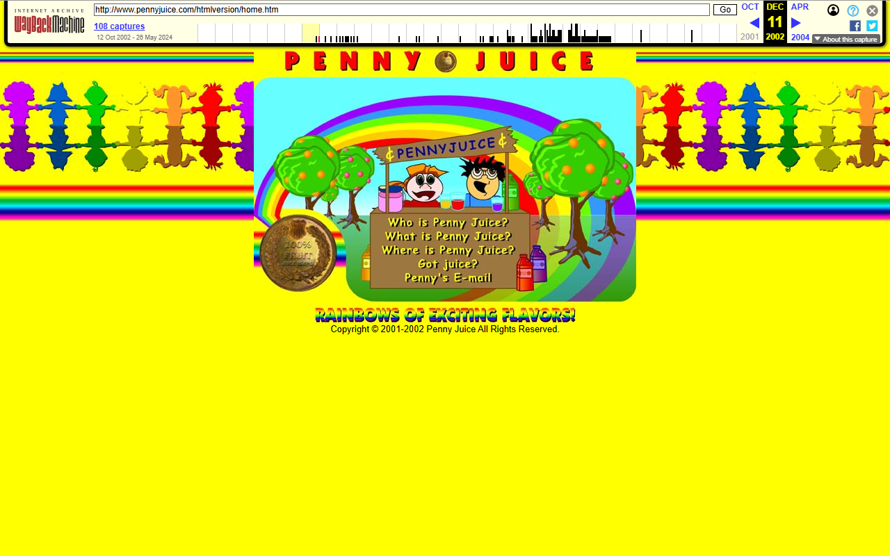
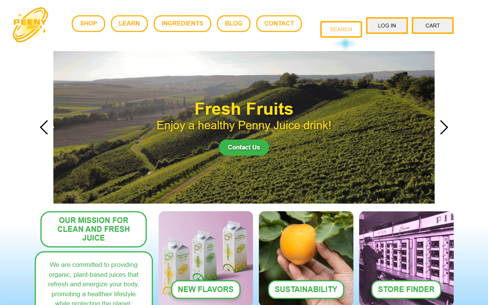
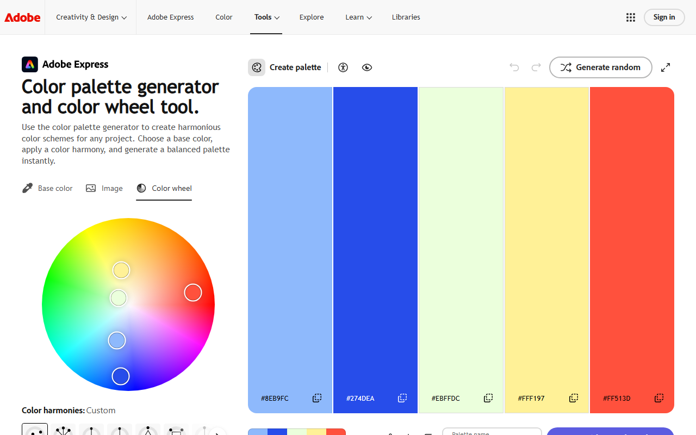
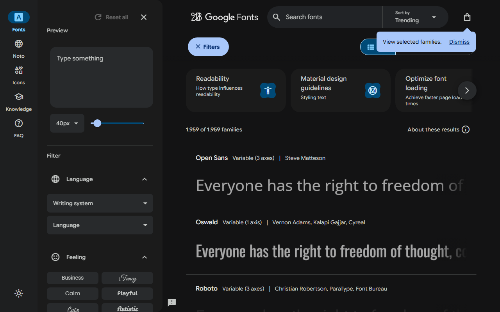
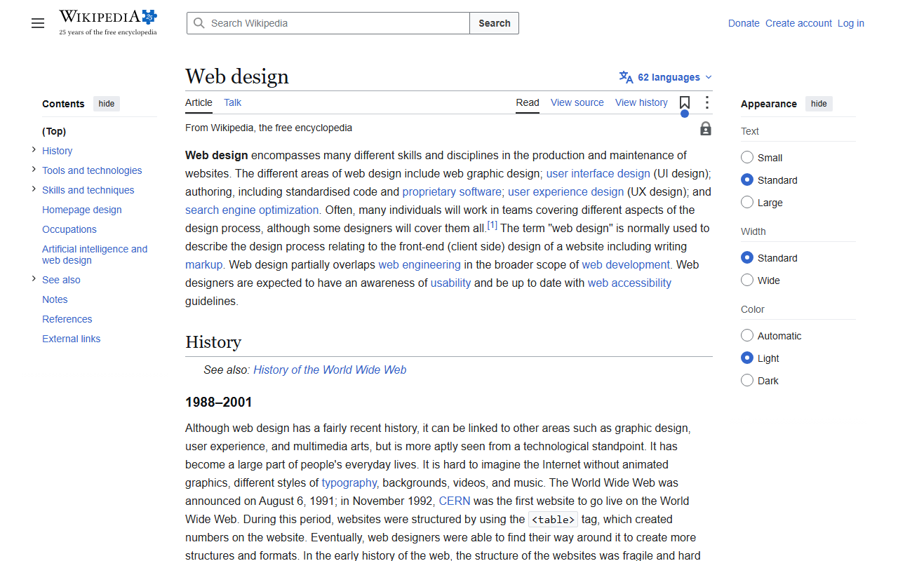
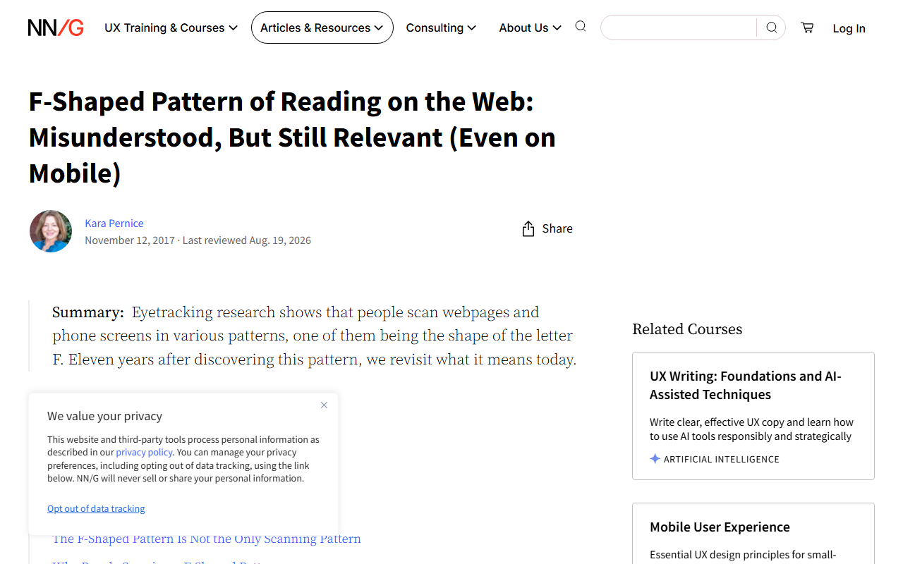
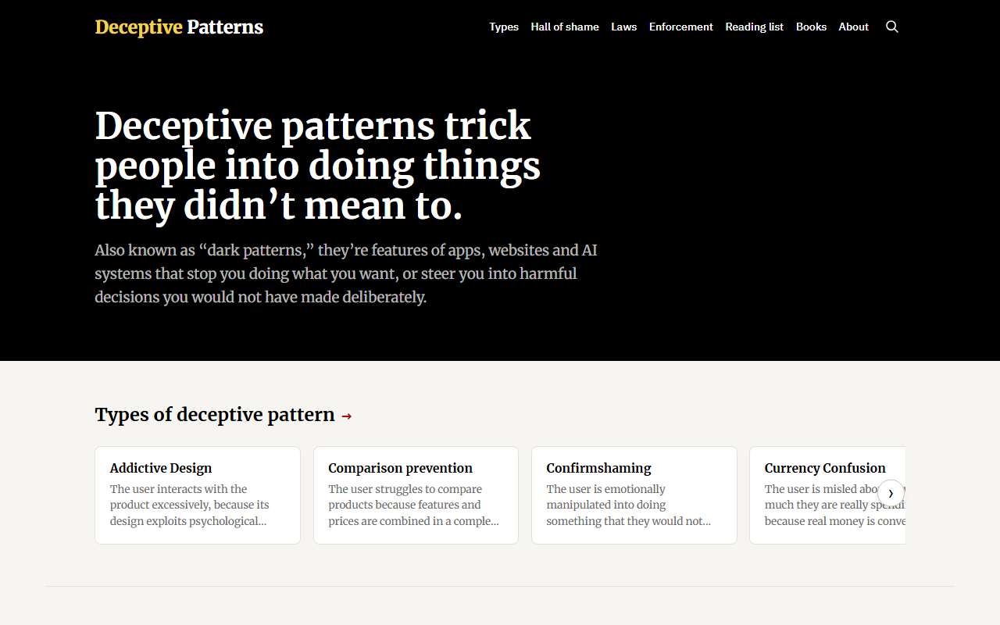
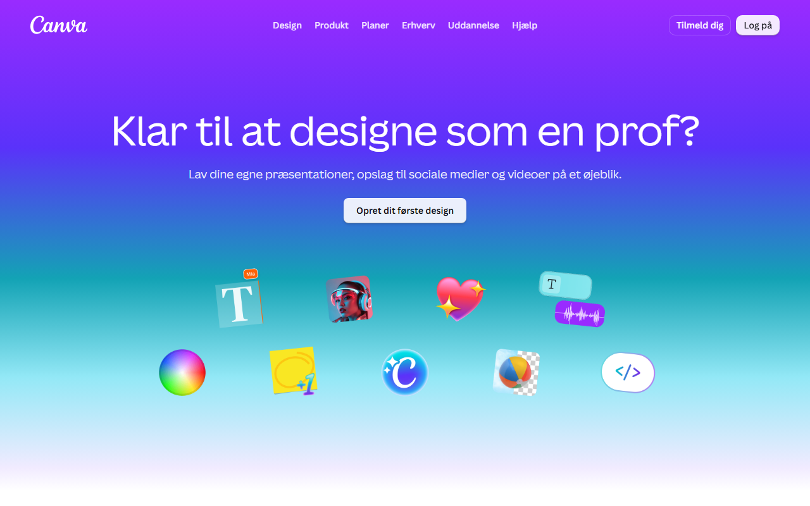
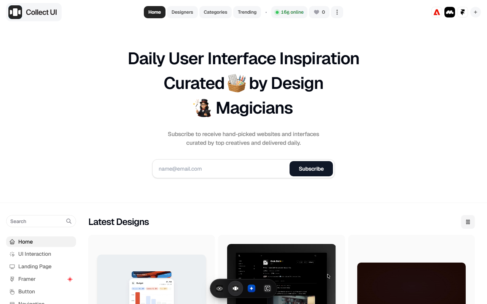

# 🚀 065-practice-webdesign

Day 65 of Udemy's *100 Days of Code: The Complete Python Pro Bootcamp*: notes and screenshots on the four pillars of web design (color theory, typography, UI and UX) and a hotel website design exercise. Documentation only, no code.

## 📚 Table of Contents

- [Overview](#-overview)
- [Requirements](#-requirements)
- [Setup](#-setup)
- [Run](#-run)
- [Tests](#-tests)
- [License](#-license)
- [Links](#-links)
- [Appendix: Project documents](#-appendix-project-documents)

## 🧭 Overview

Day 65 has six lectures and no programming assignment. This repository records what each lecture teaches, with a screenshot of a page it points to, and what we gained from it. The full notes are in the [wiki][wiki] in English, Danish (Dansk) and Bahasa Malaysia.

- `docs/` holds the wiki sources (`docs/wiki/`) and the screenshots (`docs/images/`).
- `src/` and `tests/` are intentionally absent: the day has no code.

### Lecture 1: Introduction to web design

First impressions are fast. Penny Juice shows how a cohesive color scheme and better type raise perceived value. The four pillars: color theory, typography, UI and UX.





### Lecture 2: Color theory

Colors carry meaning (red energy, yellow joy, green freshness, blue trust, purple royalty). Build palettes that are analogous, complementary, triadic or square.



### Lecture 3: Typography

Serif feels traditional, sans-serif modern. Use at most two fonts and pair contrasting styles.



### Lecture 4: User interface (UI) design

Hierarchy through size, color and white space; 40 to 60 characters per line; consistent alignment; design for the target audience.




### Lecture 5: User experience (UX) design

Simplicity, consistency, F and Z reading patterns, all-platform design, user testing, and avoiding dark patterns.





### Lecture 6: Web design in practice

Design a three-page hotel website (title, features, contact) in Canva, then publish it as a web page. Practice with [Daily UI](https://www.dailyui.co/) and find inspiration on Collect UI.





> Screenshots are taken from the public pages named in the lectures, for study. Their copyright belongs to their owners.

## 📋 Requirements

A Markdown viewer or any web browser. There are no runtime dependencies.

## 🛠️ Setup

```bash
git clone ssh://git@git.tirsystem.com:10022/Tirsvad-Udemy-100-days-of-code/065-practice-webdesign.git
cd 065-practice-webdesign
```

## ▶️ Run

There is nothing to run. Read this file and the pages in `docs/wiki/`, or open the [wiki][wiki].

## 🧪 Tests

Not applicable: the project has no code.

## 📄 License

See [LICENSE](./LICENSE).

## 🔗 Links

- [Repository][repository]
- [Documentation][documentation]
- [Issue tracker][issues]

## 📎 Appendix: Project documents

| Document | What it tells you |
| --- | --- |
| [AGENTS.md][agents] | The rules AI agents follow in this repository |
| [Artifact registry][registry] | The PO language and domain (English, IT) and the wiki languages |
| [Framework README][framework-readme] | The framework this project uses |
| [Framework changelog][framework-changelog] | What changed in each framework release |

---

[repository]: https://git.tirsystem.com/Tirsvad-Udemy-100-days-of-code/065-practice-webdesign
[documentation]: https://git.tirsystem.com/Tirsvad-Udemy-100-days-of-code/065-practice-webdesign/wiki
[wiki]: https://git.tirsystem.com/Tirsvad-Udemy-100-days-of-code/065-practice-webdesign/wiki
[issues]: https://git.tirsystem.com/Tirsvad-Udemy-100-days-of-code/065-practice-webdesign/issues
[agents]: ./AGENTS.md
[registry]: ./docs/artifact-registry.md
[framework-readme]: ./framework/README.md
[framework-changelog]: ./framework/CHANGELOG.md
